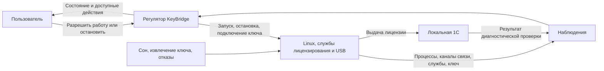

# Модель управления KeyBridge

Цель KeyBridge — обеспечить установленной на Mac программе 1С доступ к аппаратной лицензии USB-ключа. Приложение поддерживает необходимые для этого службы, пока пользователь разрешает работу. Получение лицензии конкретной программой проверяется отдельно, по запросу в диагностике.

Достижение цели зависит от исправного подходящего ключа, доступной лицензии и клиента 1С. Регулятор может восстановить собственные службы, но не создать лицензию или гарантировать её наличие. Поэтому допустимыми исходами служат также ожидание ключа, понятный отказ и сообщение о недостаточности наблюдений.

## Как использовать модель

Это контракт поведения всей программы. Ограничения обязательны при каждом переходе. Имена правил и переходов отражают их смысл, а не положение в списке. Переходы задают допустимые изменения; сценарии уточняют их ветви и интерфейс. Обозначения сохраняются при редактировании и не переиспользуются для другого смысла. Они не требуют отдельного движка или формата данных в программе.

Реализация должна выполнять все предусмотренные ветви и не добавлять самостоятельного поведения. Технические шаги допустимы только для выполнения перехода или сохранения ограничения. Место принятия решения должно быть обозримым; исполнители VM, USB и файлов не выбирают собственную политику восстановления. Связь с кодом и проверками находится в [единственной таблице соответствия](implementation.md#scenario-coverage).

## Контур управления

| Элемент модели | Содержание |
| --- | --- |
| Задание | Сохранённое разрешение работать или требование остановиться |
| Объект управления | Собственная виртуальная машина с Alpine, менеджер лицензий 1С, HASP runtime и передача USB-ключа |
| Регулятор | Агент, который сопоставляет задание с наблюдениями, выбирает допустимое действие и проверяет результат |
| Наблюдения | Принадлежность и состояние VM, доступность каналов управления, состояние служб, количество и идентичность ключей, защита прошивки, настройки клиента |
| Управляющие действия | Подготовить компоненты, настроить клиент, запустить или остановить свою VM, восстановить службы, подключить или освободить ключ |
| Обратная связь о цели | Результат операции локальной 1С и свидетельство аппаратного источника её лицензии |
| Возмущения | Сбой процесса или записи, потеря связи, отключение ключа, изменение настроек, сон, смена сеанса и перезапуск агента |

Настройка клиента и подготовка компонентов входят в путь к цели. За границей управления остаются чужие VM, другие программы и содержимое лицензии. Прошивку ключа KeyBridge не изменяет.

### Жизненный цикл самого KeyBridge

Регулятор сам является установленным приложением. Его установка, замена и удаление входят в модель как действия пользователя и macOS через Finder. Это события жизненного цикла, которые нужно наблюдать и проверять, а не дополнительные команды интерфейса KeyBridge.

Переустановка компонентов меняет Linux и описана prepare-components; замена или удаление `.app` через Finder — manage-application; внешнее изменение при работающем агенте — observe-external-change. Эти действия не подменяют друг друга. Перенос приложения в Корзину не равен удалению данных и восстановлению настроек 1С. [Сценарии жизненного цикла](scenarios/preparation.md#application-lifecycle) уточняют исходы.

## Какие сведения нельзя смешивать

| Часть состояния | Различаемые значения и сведения |
| --- | --- |
| Намерение | Работать или остановиться; отдельно запрет автоматического возобновления после обычной остановки и причина защитного запрета |
| Условия | Установка и клиент пригодны, непригодны или неизвестны; сеанс активен, приостановлен или неизвестен; обязательная запись возможна либо отказала |
| Объект | VM своя живая, достоверно отсутствует или владение неизвестно; отдельно состояние SSH, QMP, служб и защиты |
| Ключ | Отсутствует, единственный допустимый, неоднозначный или неизвестный; запрос захвата и подтверждённое подключение с его идентичностью различаются |
| Операция | Нет операции либо её вид, идентификатор, контекст, срок и оставшиеся попытки; отдельно один ожидающий запрос диагностики и намерение выхода |
| Автозапуск | Сохранённое предпочтение, поддержка сборкой, регистрация и разрешение macOS; эти факты не заменяют друг друга |
| Результат | Успех, отказ, неизвестность, отмена или тайм-аут конкретной операции; время, контекст и факт сохранения. Лицензия и ресурсы имеют собственные результаты |
| Жизненный цикл | Какая копия приложения управляет работой; текущая и сохранённые установки, пригодность данных и копии настроек |

Это части одного состояния, а не требование создать классы или перебрать их декартово произведение. В таблицах ниже «работает» означает готовность служб и подтверждённое подключение ключа, «ожидание ключа» — разрешённую работу без ключа, «выключен» — подтверждённое отсутствие своей VM. Сохранение запрета и подтверждение освобождения проверяются отдельно. Ошибка операции не превращает все факты в одно состояние «ошибка». Незатронутые части состояния сохраняются.

Каждое существенное наблюдение бывает подтверждённым, опровергнутым или неизвестным. Оно относится к определённому объекту и моменту. Противоречивое или устаревшее наблюдение не разрешает опасное действие.

Живой порт менеджера подтверждает только доступность порта. Отсутствие ответа по SSH не доказывает остановку VM. Историческая успешная проверка не подтверждает текущую выдачу. Смена запуска, установки, служб, ключа, сон, остановка или потеря наблюдения снимают актуальность прежней проверки.

## Ограничения всех действий

| Правило | Предмет | Обязательное правило |
| --- | --- | --- |
| single-owner | Владение | Один агент управляет своей VM. Новый запуск допустим после достоверного отсутствия прежней. Остановка воздействует только на подтверждённо свой процесс; одного сохранённого номера процесса недостаточно. |
| safe-usb | USB и прошивка | Подключение разрешено только для одного однозначно определённого ключа при подтверждённом запрете автоматического обновления прошивки. Запрос подключения и подтверждённое подключение различаются. |
| stop-on-unsafe-state | Потеря безопасности | Отключённая или неизвестная защита, неоднозначный ключ запрещают новый захват. Уже работающая своя VM останавливается. При неизвестном владельце приложение сообщает неопределённость и не завершает чужие процессы. |
| stop-priority | Остановка | Доступна во время любой операции. Отменяет прежние действия и отложенное восстановление. Её физический результат и сохранение запрета будущего запуска подтверждаются отдельно. |
| durable-intent | Сохранение | Работа требует достоверного сохранённого разрешения. Отказ обязательной записи запрещает зависящее от неё действие. Если утрачено основание уже выполняемой работы, предпринимается остановка; ошибка записи не отменяет её физическую попытку. Диагностические результаты и снимки интерфейса не являются основанием управления. |
| isolated-preparation | Подготовка | Компоненты устанавливаются в отдельную копию основы. Текущая установка меняется только после проверки и остановки подготовленной копии. Прежняя рабочая установка сохраняется. |
| reversible-client-settings | Настройки 1С | Чужие изменения автоматически не затираются. Каждое изменение KeyBridge предварительно сохраняет текущее состояние. Возврат восстанавливает состояние перед последним выполненным изменением KeyBridge; без достоверной копии или при последующих чужих изменениях возврат запрещён. |
| valid-results | Результаты | Принятая команда ещё не выполнена. Ответ другой или отменённой операции не меняет текущий результат. Неизвестность, ошибка и тайм-аут не превращаются в успех. |
| bounded-recovery | Восстановление | Число попыток и ожидание каждой операции конечны. Отсутствие ключа вызывает ожидание подключения; недоказанная выдача лицензии сама по себе не вызывает перезапуск исправной VM. |
| preserve-installations | Хранение | Опубликованные установки автоматически не удаляются. Нехватка места даёт объяснимый отказ; диск работающей VM не удаляется. |
| safe-app-replacement | Замена приложения | Штатный сценарий начинается с завершения KeyBridge и подтверждённой остановки своей VM. Finder заменяет `.app`; новая копия проверяет сохранённые данные и не сбрасывает их при неизвестном формате. |
| explicit-uninstall | Удаление | Прекращение работы, перенос `.app` в Корзину, отключение запуска при входе и возврат настроек 1С проверяются отдельно. Отсутствие приложения не доказывает удаления данных или очистки интеграций. Базы 1С и чужие файлы не затрагиваются. |
| justified-actions | Основание действия | Изменение работы допускается только по описанному переходу модели. Чтение состояния и навигация не запускают VM, пробу 1С или полную проверку. В исправном режиме нет периодической полной проверки компонентов. |
| distinct-inhibits | Причины запрета | Обычное выключение, приостановка сеанса и защитный запрет различаются. Автозапуск, вход, пробуждение и переподключение не снимают защитный запрет. Его снимает только явное включение после подтверждения устранения причины. |

Обычное выключение, временная приостановка сеанса и защитный запрет — разные состояния. Обычное выключение запрещает автоматическое возобновление до нового включения либо явного повторного разрешения автозапуска. Приостановка из-за сна или неактивного сеанса сохраняет желание работать; возвращение сеанса вызывает сверку условий. Защитный запрет снимается только явным «Включить» после успешной проверки устранения причины. Настройка автозапуска, вход в macOS, пробуждение и переподключение ключа этот запрет не снимают. Запрос «Включить» сам по себе не доказывает исправление.

Перед обычной заменой или удалением пользователь завершает KeyBridge. Это явный выход с сохранением запрета возобновления. Последующее копирование приложения и его открытие сами по себе не разрешают работу с ключом.

### Когда выполняются наблюдения

При подготовке проверяются выбранные компоненты и результат их установки. При включении проверяются предпосылки запуска, владение процессом, готовность служб и безопасность подключения ключа. После достижения рабочего режима регулятор реагирует на события: завершение собственного процесса, изменение USB, сон, смену сеанса, изменение установленной копии или данных. Эти события вызывают только относящиеся к ним наблюдения и действия. Проверенная пригодность неизменённых компонентов не проверяется заново по таймеру. Постоянный запуск полного набора проверок внутри Linux не предусмотрен. Это принятое ограничение проекта justified-actions, а не следствие теории управления само по себе. Оно ограничивает лишнюю работу; автоматическое обнаружение любого молчаливого зависания в требования не входит.

Наблюдаемое падение процесса обрабатывается автоматически. Молчаливое зависание, при котором процесс остаётся жив и событие отказа не поступило, обнаруживается по запросу диагностики. После обнаружения отказа действует ограниченное восстановление. Автоматическое обнаружение любого зависания без обращения пользователя не гарантируется. Таймеры ограничивают выполняемые операции и восстановление, но не запускают полную перепроверку исправной установки.

Подтверждения имеют область действия. Проверка компонентов относится к их неизменённой установленной копии; подтверждение передачи USB — к конкретному подключению и запуску VM. Переподключение, смена запуска, изменение настроек защиты, явный отрицательный ответ либо отказ соответствующего наблюдателя требуют новой проверки затронутого факта. Потеря SSH сама по себе означает потерю канала, а не опровержение ранее подтверждённой защиты при неизменном контексте. Она не разрешает новое действие, для которого требуется свежее наблюдение. Отказ самого USB-наблюдателя отличается от отказа SSH: продолжение достоверного наблюдения подключения должно быть подтверждено либо применяется защитный отказ.

### Приём команд во время операции

Правило [admit-command](#admit-command) различает немедленную остановку, чтение снимка, одну ожидающую диагностику и отказ конфликтующей команде. Ожидание не считается выполнением; отклонённый запуск не может выполниться позднее. Ожидание диагностики должно быть видно в интерфейсе.

### Какие записи обязательны

| Данные | Правило при отказе записи |
| --- | --- |
| Разрешение работать, запрет возобновления, причина защитного запрета и оставшиеся попытки восстановления | Не начинать действие без сохранённого основания. При утрате основания уже выполняемой работы попытаться остановить её. Выключение физически выполняется и при ошибке сохранения запрета; устойчивый запрет не обещается до записи. |
| Приём и публикация управляющего действия, меняющего VM, подключение ключа, выбранную установку или настройки клиента | До воздействия отказать, если обязательный приём не сохранён. Исключение — физическая остановка подтверждённо своей работы: её попытка обязательна и при отказе сохранения приёма, намерения или результата (stop-priority, durable-intent). При неизвестном исходе не повторять действие вслепую: сверить факты; если безопасное основание продолжения не установлено, остановить свою работу. |
| Выбор текущей установки и сведения о завершении переключения | Не объявлять переключение успешным без сохранения. Сохранить прежнюю установку; при неизвестном результате установить фактический выбор до запуска. |
| Состояние настроек 1С перед изменением и сведения, связывающие копию с этим изменением | Не изменять настройки без достоверной копии. После неизвестного исхода записи сначала сверить факты; не затирать чужие изменения и не выдумывать прежнее состояние. |
| Предпочтение автозапуска и регистрация macOS | При отказе сохранить прежнее предпочтение, восстановить и проверить регистрацию. Изолированный отказ не прекращает уже разрешённую работу и не снимает защитный запрет. |
| Результат диагностики, измерение ресурсов, снимок для интерфейса | Продолжать разрешённую исправную раздачу, показать ошибку сохранения возле результата. Несохранённый результат не выдаётся за доступный после перезапуска. |

## Как регулятор выбирает действие

События обрабатываются последовательно. Перед воздействием и публикацией результата проверяются относящиеся к ним ограничения. Таблицы задают переходы одного регулятора; группировка по разделам не означает отдельных подсистем.

### Приоритет и завершение

При конфликте ещё не выполненных действий применяется такой порядок:

1. Остановка или явный выход отменяют прежнюю операцию и ожидающую диагностику. Повтор остановки присоединяется к ней, не сбрасывая срок. Одновременно обнаруженная причина защитного запрета сохраняется: обычная остановка её не стирает.
2. Защитный отказ запрещает продолжение и отменяет конфликтующие действия. Он не отменяет уже принятую остановку или намерение выхода.
3. Сон, неактивный сеанс и системное завершение приостанавливают работу и отменяют ожидание диагностики. Они не снимают ни обычный, ни защитный запрет.
4. Результат принимается только для действующей операции и неизменного контекста. Отмена, истёкший срок и потеря необходимого разрешения исключают публикацию успеха. Остальные допустимые команды обрабатываются в порядке приёма с проверкой занятости.

Приоритет не обращает уже совершённое действие. Если переключение установки подтверждено до принятия остановки, новая установка остаётся выбранной; если остановка принята раньше, позднее переключение запрещено.

Для каждой строки успех означает проверенный эффект, а не отправленный запрос. Начало длительного действия устанавливает текущую операцию; её завершение проходит через finish-operation. Отказ до воздействия сохраняет объект; при частичном или неизвестном эффекте регулятор устанавливает факты и сообщает их, а не предполагает откат. До выяснения запрещены действия, которым недостаёт основания, с обязательной защитной остановкой в случаях stop-on-unsafe-state, stop-priority, durable-intent. Неуказанные в строке части состояния сохраняются.

### Подготовка и настройки клиента

| Переход | Исходное состояние и событие | Условие и действие | Успех | Отказ, отмена или неизвестность |
| --- | --- | --- | --- | --- |
| open-application Открыть приложение | Первый или повторный ручной запуск | Проверить копию приложения, данные и владельца агента/VM | Показать подготовку либо действующую установку и её состояние; живой агент продолжает прежнюю разрешённую работу | Другая копия агента, повреждение или неизвестный формат дают явную причину; нет второй VM, сброса данных и нового разрешения работать |
| inspect-installers Проверить файлы | Выбор или замена установщика | Сохранить отдельную копию; проверить формат, архитектуру и состав; при нескольких кандидатах получить выбор пользователя | Оба пригодных компонента разрешают подготовку | Непригоден только соответствующий файл; прежний ответ не применим к новому выбору, второй компонент сохраняется |
| prepare-components Подготовить или заменить компоненты | Пользователь запускает установку; работа с ключом выключена | Проверенные копии и достаточные ресурсы; создать отдельную основу, установить, проверить и остановить её, затем переключить текущую установку | Новая установка выбрана, прежняя сохранена; автоматического включения нет | До переключения прежняя установка остаётся текущей; при неизвестном исходе переключения сначала выяснить выбор. Отмена останавливает подготовку, поздняя публикация запрещена |
| configure-client Настроить или исправить поиск | KeyBridge выключен; явное действие настройки | Найти подходящий клиент; перед изменением сохранить текущие настройки и связь копии с операцией; получить права и записать изменение. Для внешних настроек нужно явное подтверждение исправления | Поиск настроен; исправные настройки повторно не записываются | Нет клиента, копии или прав — отказ до изменения. Частичный/неизвестный эффект требует сверки; неудачная попытка не подменяет точку возврата |
| rollback-components Вернуть установку | Проблема обновления; пользователь выбирает возврат | Подтвердить выключение и пригодность предыдущей установки, переключить выбор | Предыдущая установка текущая; включение только явное, старая проба историческая | Если работа ещё идёт — предложить выключение. Нет пригодной копии — предложить переустановку. Неизвестный выбор сверить до запуска; данные не удалять |
| restore-client-settings Вернуть настройки | Пользователь выбирает возврат; KeyBridge выключен | Проверить происхождение копии и отсутствие последующих внешних изменений; восстановить состояние перед последним выполненным изменением, включая отсутствие файла | Прежний поиск восстановлен; повтор без нужды ничего не меняет | Нет достоверной копии или есть конфликт — не писать. Отказ прав/записи сообщить; неизвестный эффект проверить |

### Работа и обратная связь

| Переход | Исходное состояние и событие | Условие и действие | Успех | Отказ, отмена или неизвестность |
| --- | --- | --- | --- | --- |
| start Включить | Явная команда пользователя | При свободном исполнителе проверить условия и сохранить намерение; запустить свою VM, проверить службы и защиту, затем применить wait-for-key/attach-key. Защитный запрет снимается только после подтверждения устранения причины, до этого захват запрещён | Работа либо ожидание ключа | Занятость — admit-command; непригодность, запись, ресурсы или чужой порт — явный отказ. Неизвестный владелец запрещает запуск; провал проверки защиты — safety-stop |
| stop Выключить, отменить подготовку или выйти | Команда допустима при любой операции и неизвестном состоянии | Отозвать прежние действия и ожидание, сохранить выключение, остановить подтверждённо свою работу; при отказе записи всё равно попытаться остановить | Физическая остановка и сохранённый запрет подтверждены отдельно; при выходе дополнительно подтверждено завершение своего агента | Неизвестный процесс не завершать. Неподтверждённую остановку не объявлять успешной. Несохранённый запрет дать сохранить повторно; намерение выхода не теряется при ошибке |
| finish-operation Завершить операцию | Результат, отмена или срок текущей операции | Проверить идентичность, контекст, разрешение и эффект; сохранить требуемый результат. После отмены/тайм-аута прекратить незавершённые действия, не оставляя им права на публикацию | Завершить операцию её собственным результатом; ожидающая диагностика допускается только после новой проверки условий | Чужой/поздний ответ не меняет текущий результат. Неизвестный эффект требует сверки. Отказы записи различаются по перечню обязательных записей; повторное ожидание не продлевает срок |
| admit-command Принять команду при занятости | При выполняемой операции пришла команда | Остановку принять через stop; чтение — show-state; одну допустимую диагностику явно поставить в ожидание. Независимое предпочтение автозапуска допускается через set-autostart | Показать принятие, ожидание либо текущий снимок, не выдавая их за выполнение | Включение и другие конфликтующие команды отклонить без очереди. Вторую диагностику, диагностику при остановке или нарушенных условиях отклонить. Остановка, защитный отказ, завершение сеанса и перезапуск отменяют ожидание |
| wait-for-key Ожидать ключ | Работа разрешена; ключ отсутствует или штатно извлечён | Снять актуальность подключения и пробы, сохранить разрешённую работу служб, ждать события подключения | Ожидание ключа с доступной остановкой | Само отсутствие не вызывает защитного запрета и перезапусков. Неоднозначность или отказ наблюдателя — отдельный safety-stop; пока выключено, подключение не разрешает работу |
| attach-key Подключить ключ | Работа разрешена; появился единственный допустимый ключ | Подтвердить службы, защиту, владельца и новый USB-контекст; передать ключ и проверить фактический захват | Работает; факт выдачи лицензии ещё не подтверждён | Нет ключа — wait-for-key; нарушение защиты/наблюдения — safety-stop; потеря канала — recover-channel. Повторный захват уже исправно подключённого ключа запрещён |
| safety-stop Защитный отказ | Событие или завершённая проверка выявили неоднозначный ключ, нарушенную/неизвестную защиту, отказ USB-наблюдателя или утрату обязательного основания работы | Запретить захват и продолжение, отменить операции и ожидание, сохранить причину; остановить только свою подтверждённую VM | Защитный запрет; физический результат остановки указан отдельно | Отказ записи не отменяет остановку. При неизвестном владельце — явная неизвестность без воздействия на чужие процессы. Возобновление только через start после исправления |
| recover-runtime Восстановить объект | Работа разрешена; событие или диагностика подтвердили отказ VM/службы | Потратить сохранённую попытку и восстановить затронутый объект; службу восстанавливать без перезапуска исправной VM, новый запуск VM только после подтверждения отсутствия прежней | Работа или ожидание ключа; старая проба недействительна | Ограничить срок и число попыток; после исчерпания — конечный отказ и действие пользователя. Ресурсную причину назвать только при подтверждении; память молча не увеличивать |
| recover-channel Восстановить канал | Своя VM жива; обнаружена потеря SSH либо QMP | При потере SSH и неизменном подтверждённом USB-контексте сначала ограниченно восстанавливать связь без прерывания раздачи. При потере QMP контроль USB неизвестен: остановить свою VM до нового запуска | Связь восстановлена и факты сверены; раздача сохранена там, где это допустимо | SSH не означает остановку VM или отключённую защиту. Новые действия без свежего основания запрещены. При необходимости перезапуска сначала подтвердить остановку; после неудачных попыток — конечная ошибка |
| recover-agent Восстановить агент | Агент запущен после сбоя | Прочитать намерение, запреты и оставшиеся попытки; заново установить владельца и контекст; незавершённые команды не воспроизводить | Подтверждённо свою живую и безопасную работу принять; отсутствующую восстановить только при разрешении | Неизвестность запрещает дубль. Если безопасность прежнего подключения не установлена — safety-stop; принятие живой VM требует подтверждённого USB-контекста. Оставшиеся попытки не пополнять |
| suspend-session Приостановить сеанс | Сон, неактивный сеанс или системное завершение | Отменить конфликтующие действия и ожидание диагностики, приостановить работу, отозвать актуальность пробы; при системном завершении освободить ресурсы и завершить агент | Намерение будущей работы сохранено; системный выход не становится обычным выключением | Неизвестная активность не разрешает запуск. Неподтверждённое освобождение не объявлять выполненным; ранее принятые выключение и защитный запрет сохраняются |
| resume-session Возобновить сеанс | Пробуждение или возврат активного сеанса | Сверить состояние и восстановить только сохранённую разрешённую работу | Работа, ожидание ключа либо сохранённое выключение | Запрет не снимается; бюджет не обновляется как при новом входе, старая проба не становится текущей |
| handle-login Обработать вход | Новый вход в macOS | Проверить автозапуск, регистрацию, разрешение ОС, установку, клиент и отсутствие запретов; сохранить новый бюджет разрешённого запуска | Принять свою работу либо начать её без дубля | Любое невыполненное или неизвестное условие запрещает автоматический запуск; показать причину при открытии |
| set-autostart Изменить автозапуск | Пользователь меняет предпочтение, восстанавливает регистрацию или повторяет проверку | Проверить поддержку, изменить и проверить регистрацию, затем сохранить выбор; проверка разрешения только обновляет наблюдение | Новое предпочтение и фактическое разрешение показаны отдельно; явное повторное разрешение снимает только обычный запрет | При ошибке записи восстановить прежнюю регистрацию и проверить её; ошибку отката показать отдельно. Текущая раздача не прекращается, защитный запрет не снимается; отмена убирает только несохранённый выбор |

### Диагностика и внешние действия

| Переход | Исходное состояние и событие | Условие и действие | Успех | Отказ, отмена или неизвестность |
| --- | --- | --- | --- | --- |
| inspect-runtime Проверить состояние | Запрос диагностики состояния или относящееся к объекту событие | Проверить затронутые факты, объяснить причину и допустимое действие; при подтверждённом отказе применить соответствующий переход восстановления | Актуальный результат о компонентах; проба 1С без отдельной команды не запускается | Неизвестную причину назвать неизвестной; не выводить отсутствие лицензии из общего сбоя. Занятость — admit-command |
| probe-license Проверить в 1С | Явный запрос; работает KeyBridge, ключ подключён, клиент настроен | Создать отдельную пустую базу, выполнить операцию 1С и проверить связь аппаратной выдачи именно с ней; при ожидании повторно проверить условия | Подтверждение только при успешной операции, доказанном источнике и неизменном контексте; подтверждённая повторная проба снимает проблему обновления | Успешный клиент без связи с выдачей — «не подтверждено»; ошибка/тайм-аут клиента — собственный отказ. Смена контекста отменяет актуальность. Исправная VM из-за результата пробы не перезапускается |
| open-license-monitor Открыть монитор | Пользователь выбирает просмотр лицензий | Открыть штатный монитор установленной 1С | Подтверждённое открытие инструмента; сведения о лицензиях предоставляет 1С | Создание процесса не доказывает открытие окна и получение данных. При отказе/неизвестности дать повтор или инструкцию, сохраняя исправную раздачу |
| measure-resources Измерить ресурсы | Пользователь запрашивает измерение; работа может быть выключена | Измерить доступные объекты, связать значения со временем и контекстом | Память гостя и процесса Mac, занятые блоки и ёмкость диска различаются | Недоступные данные не равны нулю; прежние обозначаются историческими. Ошибка сохранения не останавливает раздачу. Измерение не удаляет установки и не меняет память |
| manage-application Установить, заменить или удалить приложение | Действие пользователя через Finder | Перед заменой/удалением — stop; при необходимости отдельно вернуть настройки и выключить автозапуск. Finder копирует/удаляет `.app`, следующий запуск — open-application | Полная новая копия использует сохранённые данные; удаление приложения не означает удаления данных или возврата настроек | Отмена не считается выполнением; повреждённую копию заменяют полной. Без работающего агента не обещается немедленная очистка. Открытие новой копии не отменяет выключение |
| observe-external-change Обнаружить внешнее изменение | Изменены приложение, данные, настройки или их доступность | Обновить относящиеся наблюдения и отменить актуальность зависимых результатов. Непригодная копия регулятора/утрата основания работы — safety-stop; конфликт настроек требует явного configure-client | Согласованное состояние без скрытого сброса, удаления и перезаписи | Повреждение отличается от отсутствия; неизвестный формат не запускается. Утрата данных не доказывает отсутствие процесса. Возврат записи разрешает повтор сохранения, но не включает работу |
| show-state Показать состояние или справку | Чтение состояния, закрытие/открытие окна, навигация, инструкция своей базы или ссылка разработчика | Показать доступный снимок с актуальностью; сохранить навигацию/фокус; сайт открыть во внешнем браузере только по действию пользователя | Представление изменено, задание регулятора сохранено; закрытие окна оставляет разрешённую работу | Нет живого агента — снимок исторический. Просмотр не запускает VM, пробу, полную проверку или загрузку сайта; ручное чтение лицензии не меняет автоматическое подтверждение |
| reject-unsupported Отклонить неподдерживаемое | Неизвестная команда или нераспознанное событие | Команде дать явный отказ; у события обозначить неизвестность затронутого факта и запретить зависящие действия, применяя stop-on-unsafe-state, stop-priority, durable-intent при необходимости | Нет произвольного нового поведения | Эта ветвь не заменяет описание известной ситуации с отсутствующим переходом. Такой пробел модели указывается отдельно |

## Как из модели получаются сценарии

| Основание в модели | Поведение пользователя и системы |
| --- | --- |
| Объект управления должен существовать и быть пригодным | [Подготовка из двух установщиков, настройка 1С](scenarios/preparation.md) |
| Замена объекта не должна уничтожить рабочий вариант | [Обновление компонентов и возврат после неудачного обновления](scenarios/preparation.md) |
| Сам регулятор тоже устанавливается, заменяется и удаляется | [Установка, обновление, переустановка и удаление приложения](scenarios/preparation.md#application-lifecycle) |
| Пользователь задаёт режим, регулятор его поддерживает | [Включение, остановка, закрытие окна и выход](scenarios/operation.md) |
| Нужны наблюдения о работе ключа | [Просмотр занятых лицензий](scenarios/operation.md) |
| Доступность служб отличается от достижения цели | [Проверка в 1С и разбор неподтверждённого результата](scenarios/diagnostics.md) |
| Возмущения требуют реакции и ограниченного восстановления | [Отказы, потеря ключа и восстановление](scenarios/diagnostics.md), [фоновые события](scenarios/operation.md) |
| Возобновление требует сохранённого разрешения | [Запуск при входе в macOS](scenarios/settings.md) |
| Пользователь должен вернуть прежнее поведение клиента | [Восстановление настроек 1С](scenarios/settings.md) |
| Работа ограничена ресурсами и должна быть наблюдаема | [Расход памяти и места на диске](scenarios/settings.md) |

Основной участник пользовательских сценариев — пользователь этого Mac. Он действует через KeyBridge, его установку или удаление; прямое изменение файлов через Finder является внешним действием. macOS предоставляет системные разрешения, а локальная 1С участвует в проверке и просмотре лицензий. Фоновые события не требуют выдуманного нажатия пользователем.

## Что считается подтверждением лицензии

Положительный результат требует успешной операции клиента без тайм-аута, достоверного аппаратного источника лицензии именно этой операции и неизменного контекста проверки. Если клиент завершил работу, но источник установить нельзя, результат остаётся неподтверждённым. Если клиентская операция не завершилась, приложение показывает её отказ.

Прирост общего счётчика менеджера сам по себе не связывает выдачу с проверкой. Отсутствие прироста также недостаточно для вывода об отказе: сценарий должен учитывать уже используемую компьютером лицензию. Важна причинная связь, а не выбранный технический счётчик. Возможности нынешнего способа наблюдения описаны в [реализации](implementation.md#license-evidence).

## Ограничения выбранного решения

Открытая основа Alpine с glibc готовится при сборке приложения. На Mac пользователя в её копию устанавливаются выбранные менеджер лицензий 1С и HASP runtime без загрузки дополнительных пакетов и без промежуточной Debian VM. Закрытые компоненты и пользовательские приватные ключи в основу не входят.

Рабочая VM использует 128 МиБ гостевой памяти, один vCPU и не использует swap. Временный swap подготовки удаляется до публикации. Потребление процесса VM на Mac измеряется отдельно: оно не равно объёму гостевой памяти. Максимальные допустимые размеры диска и потребление памяти Mac не установлены.

Установщики распознаются по формату, архитектуре и назначению компонентов. Предварительная проверка Linux-файла на Mac не подтверждает его полный состав. Другая совместимая версия или заранее неизвестный хеш сами по себе не являются причиной отказа; целостность переноса проверяется отдельно.

## Границы полноты и гарантий

Соответствие проверяется в обе стороны:

- **Модель → код:** для каждого перехода и ограничения нужны место решения, исполнитель, проверка и фактический результат либо конкретный разрыв. Проверка включает применимые успех, отказ, неизвестность, отмену и тайм-аут, а также отсутствие запрещённых действий.
- **Код → модель:** каждая ветвь, меняющая поведение, обоснована переходом или ограничением. Технические шаги могут детализировать действие, но не добавлять собственные команды, повторы, состояния управления или политику восстановления.

Ожидаемый результат проверки определяется моделью. Соответствие нельзя установить только по числу зелёных тестов или наличию функции с подходящим названием. У переходов с общим ограничением проверяются также конфликтующие последовательности событий. Простота реализации оценивается отдельно: соответствующий модели код тоже может содержать лишние абстракции. Таблица соответствия ведётся в [реализации](implementation.md#scenario-coverage), без параллельного реестра.

Примеры обязательных проверок последовательностей (не исчерпывающий набор):

| Ситуация проверки | Обязательный исход |
| --- | --- |
| admit-command, justified-actions. Включение отклонено во время другой операции; она позднее завершилась | Отклонённый запуск не выполняется. |
| stop, finish-operation, admit-command, safety-stop, suspend-session. Диагностика ожидает; приняты выключение, завершение сеанса или защитный отказ | Ожидающая диагностика отменена и не запускается поздним ответом. |
| justified-actions. Работа исправна, событий и команд нет | Нет повторного запуска проверок компонентов; молчаливое зависание не обещается обнаружить автоматически. |
| configure-client, restore-client-settings, reversible-client-settings. Настройки А заменены KeyBridge, затем пользователь установил Б, затем KeyBridge явно исправил поиск | Возврат восстанавливает Б. Если после исправления появились настройки В, возврат блокируется без их перезаписи. |
| recover-channel, single-owner, safe-usb, stop-on-unsafe-state. SSH потерян при живой своей VM и неизменном подключении ключа | Сначала восстанавливается связь; нет ложной остановки, нового захвата USB или немедленного прерывания только из-за SSH. |
| finish-operation, probe-license, measure-resources, durable-intent. Отказала запись результата диагностики либо измерения | Раздача продолжается; результат показан как несохранённый. Отказ записи основания управления имеет отдельный исход по таблице обязательных записей. |
| safety-stop, resume-session, handle-login, set-autostart, distinct-inhibits. Защитный запрет установлен; произошли вход, пробуждение, переподключение или изменение автозапуска | Раздача не возобновляется. Явное включение также не разрешает её до подтверждённого исправления. |

Эти свойства задают обязательства для проверки модели и реализации, а не утверждают, что соответствующие тесты уже пройдены.

Область проверки полноты включает рабочие команды, жизненный цикл приложения и компонентов, наблюдения об объекте, завершения операций, течение времени и внешние события. Для этих групп заданы условия, действия и исходы; неизвестные данные имеют собственную реакцию. Перечень групп задаёт область проверки, но сам по себе не доказывает полноту: пропуск обновления или удаления регулятора нельзя закрыть общей ветвью «неизвестное событие».

Для однозначного поведения должны быть разделены классы событий и разрешены конфликты действий. Таблица фиксирует эти обязательства, но не является формальной проверкой всех переходов. Общая реакция на неизвестность сама по себе также не доказывает достаточность модели: известные ситуации, требующие разных действий, должны быть различимы по наблюдениям или иметь общий допустимый выход. Например, отсутствие SSH не позволяет выбрать между «VM остановлена» и «VM работает без связи», поэтому требуется отдельная проверка владельца и процесса.

Безопасность обосновывается сохранением ограничений после каждого перехода: в исходном состоянии опасные действия не разрешены, а каждое следующее действие требует соответствующего подтверждения. Конечное число попыток и конечный срок каждой операции исключают бесконечное восстановление одной непрерывно выполняемой операции. Ожидание нового внешнего события, например подключения ключа, может продолжаться без ограничения, сохраняя доступность остановки.

Эти рассуждения опираются на достоверность свежих наблюдений, единственного владельца управления, непереиспользуемую идентичность операций, атомарность подтверждённой записи и исполнение таймеров. Они не устанавливают соответствие всего кода модели и не обещают завершение при бесконечных новых прерываниях. Формальная проверка всех переходов нынешней реализации отсутствует; область практических проверок указана в [реализации](implementation.md#verification).

Есть и принципиальная граница хранения. Если после сохранённого включения запись отказала, затем пользователь потребовал остановку, а агент упал до её сохранения, на диске останутся те же данные, что при падении без остановки. Восстановитель не может различить эти две истории. Поэтому устойчивый запрет обещается только после подтверждённой записи; физическая попытка остановки всё равно обязательна. Потеря всех сохранённых копий также не позволяет гарантировать восстановление установки.

Есть и граница доступности исполнителя. Если пользователь извне удалил все компоненты KeyBridge, приложение не может гарантировать немедленное обнаружение события или самостоятельную очистку оставшихся настроек. Для проверки оставшихся данных или настроек нужна снова установленная копия либо системные средства macOS. Исчезновение `.app` не доказывает завершение процессов, снятие регистрации входа или удаление пользовательских данных.

После утраты всех следов прежней установки её невозможно отличить от отсутствия установки в прошлом. Различение первого запуска и восстановления обещается только по сохранившимся наблюдениям. При их отсутствии выбирается безопасная новая подготовка после проверки текущих процессов и интеграций, без утверждения, что KeyBridge никогда не устанавливался.
