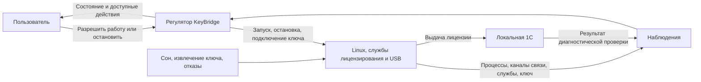

# KeyBridge как объект с регулятором

Цель KeyBridge — обеспечить установленной на Mac программе 1С доступ к аппаратной лицензии USB-ключа. Приложение поддерживает необходимые для этого службы, пока пользователь разрешает работу. Получение лицензии конкретной программой проверяется отдельно, по запросу в диагностике.

Достижение цели зависит от исправного подходящего ключа, доступной лицензии и клиента 1С. Регулятор может восстановить собственные службы, но не создать лицензию или гарантировать её наличие. Поэтому допустимыми исходами служат также ожидание ключа, понятный отказ и сообщение о недостаточности наблюдений.

## Контур управления

| Элемент модели | Содержание |
| --- | --- |
| Задание | Сохранённое разрешение работать или требование остановиться |
| Объект управления | Собственная виртуальная машина с Alpine, менеджер лицензий 1С, HASP runtime и передача USB-ключа |
| Регулятор | Агент, который сопоставляет задание с наблюдениями, выбирает допустимое действие и проверяет результат |
| Наблюдения | Принадлежность и состояние VM, доступность каналов управления, состояние служб, количество и идентичность ключей, защита прошивки, настройки клиента |
| Управляющие действия | Подготовить компоненты, настроить клиент, запустить или остановить свою VM, восстановить службы, подключить или освободить ключ |
| Обратная связь о цели | Результат операции локальной 1С и свидетельство аппаратного источника её лицензии |
| Возмущения | Сбой процесса или записи, потеря связи, отключение ключа, изменение настроек, сон, смена сеанса и перезапуск агента |

Настройка клиента и подготовка компонентов входят в путь к цели. За границей управления остаются чужие VM, другие программы и содержимое лицензии. Прошивку ключа KeyBridge не изменяет.

## Какие сведения нельзя смешивать

| Сведения | Что хранится и для чего используется |
| --- | --- |
| Желание пользователя | Разрешена ли работа; отдельно — настройка запуска при входе и запрет автоматического возобновления после остановки |
| Возможность выполнить желание | Пригодна ли установка, настроена ли 1С, активен ли сеанс, доступна ли запись, есть ли разрешение macOS на автозапуск |
| Наблюдаемое состояние | Своя VM работает, достоверно отсутствует либо её принадлежность неизвестна; состояние каналов, служб и ключа |
| Текущая операция | Какое действие принято, какой ответ ему принадлежит, отменено ли оно и истёк ли срок ожидания |
| Проверка лицензии | Что произошло в конкретной проверке, когда она выполнена и к какому запуску, установке, службам и подключению ключа относится |
| Расход ресурсов | Что, когда и для какой установки измерено; какие данные недоступны или уже относятся к прошлому запуску |

Каждое существенное наблюдение бывает подтверждённым, опровергнутым или неизвестным. Оно относится к определённому объекту и моменту. Противоречивое или устаревшее наблюдение не разрешает опасное действие.

Живой порт менеджера подтверждает только доступность порта. Отсутствие ответа по SSH не доказывает остановку VM. Историческая успешная проверка не подтверждает текущую выдачу. Смена запуска, установки, служб, ключа, сон, остановка или потеря наблюдения снимают актуальность прежней проверки.

## Ограничения всех действий

| Предмет | Обязательное правило |
| --- | --- |
| Владение | Один агент управляет своей VM. Новый запуск допустим после достоверного отсутствия прежней. Остановка воздействует только на подтверждённо свой процесс; одного сохранённого номера процесса недостаточно. |
| USB и прошивка | Подключение разрешено только для одного однозначно определённого ключа при подтверждённом запрете автоматического обновления прошивки. Запрос подключения и подтверждённое подключение различаются. |
| Потеря безопасности | Отключённая или неизвестная защита, неоднозначный ключ запрещают новый захват. Уже работающая своя VM останавливается. При неизвестном владельце приложение сообщает неопределённость и не завершает чужие процессы. |
| Остановка | Доступна во время любой операции. Отменяет прежние действия и отложенное восстановление. Её физический результат и сохранение запрета будущего запуска подтверждаются отдельно. |
| Сохранение | Работа требует достоверного сохранённого разрешения. Отказ записи операционного намерения или необходимых для управления данных запрещает продолжение; попытка остановки выполняется даже при ошибке записи. |
| Подготовка | Компоненты устанавливаются в отдельную копию основы. Текущая установка меняется только после проверки и остановки подготовленной копии. Прежняя рабочая установка сохраняется. |
| Настройки 1С | Чужие изменения автоматически не затираются. Явное исправление предварительно сохраняет текущий файл; без достоверной копии восстановление запрещено. |
| Результаты | Принятая команда ещё не выполнена. Ответ другой или отменённой операции не меняет текущий результат. Неизвестность, ошибка и тайм-аут не превращаются в успех. |
| Восстановление | Число попыток и ожидание каждой операции конечны. Отсутствие ключа вызывает ожидание подключения; недоказанная выдача лицензии сама по себе не вызывает перезапуск исправной VM. |
| Хранение | Опубликованные установки автоматически не удаляются. Нехватка места даёт объяснимый отказ; диск работающей VM не удаляется. |

Защитный отказ сохраняет запрет автоматического возобновления. После устранения причины работа требует нового явного включения. Успешно сохранённую остановку не обходят пробуждение, вход в macOS, перезапуск агента или поздний ответ. Новый запуск либо явное повторное разрешение автозапуска могут снять запрет.

Изолированный отказ сохранить предпочтение автозапуска оставляет прежнюю настройку и текущую разрешённую работу. Это отличается от потери возможности сохранять операционное намерение и состояние, необходимое для управления.

## Как регулятор выбирает действие

События обрабатываются последовательно. Результат относится к текущей операции только при совпадении её идентичности и контекста; остальные ответы отбрасываются. Таблица группирует реакции на разные события. Перед каждым действием проверяются относящиеся к нему ограничения: остановка отменяет конфликтующую работу, защитный отказ запрещает опасные действия. Чтение состояния и независимое изменение предпочтения не требуют запуска VM.

| Ситуация и наблюдение | Решение и действие | Ожидаемый исход |
| --- | --- | --- |
| Пользователь требует остановку или выход | Снять разрешение продолжения, сохранить запрет, отменить старую операцию, остановить свою VM | Подтверждённое прекращение и сохранённый запрет либо отдельно названный отказ одного из этих действий |
| Владение VM неизвестно | Запретить новый запуск и воздействие на недостоверно определённый процесс; повторить наблюдение | Установленное владение либо явная неизвестность без второго запуска |
| Нарушена защита ключа или утрачено операционное основание работы | Прекратить разрешённую работу; остановить известную свою VM | Безопасная остановка либо сообщение, почему её невозможно подтвердить |
| Сеанс неактивен или Mac засыпает | Приостановить работу, отозвать актуальность проверки, сохранить желание пользователя | После возвращения — свежая сверка с учётом сохранённой остановки |
| Идёт операция | Принимать только относящийся к ней результат; контролировать срок, отклонять конфликтующие новые команды, продолжать наблюдения | Подтверждённый исход, отмена или конечный отказ; повторная остановка не продлевает ожидание |
| Принята новая допустимая команда | Проверить условия её сценария и начать одну операцию | Исход соответствующего сценария; при невыполненных условиях — отказ с действием для исправления |
| Восстанавливается агент или возобновляется сеанс | Сверить факты заново и применить сохранённое желание | Принять свою живую VM под управление или восстановить отсутствующую без дубля; старую проверку не оживлять |
| Произошёл вход в macOS | Проверить настройку автозапуска, разрешение ОС, пригодность установки и клиента, запись и отсутствие запрета | Разрешённый автоматический запуск либо сохранение остановленного состояния с причиной |
| Работа разрешена, своя VM отсутствует или её каналы/службы отказали | Выполнить ограниченное восстановление; перед повторным запуском подтвердить остановку прежнего | Готовность либо ошибка после исчерпания попыток |
| Работа разрешена, службы готовы, ключ отсутствует | Ожидать подключение без постоянных перезапусков | Ожидание ключа с доступной остановкой |
| Работа разрешена, единственный ключ доступен, защита и службы подтверждены | Подключить ключ и проверить фактическое подключение | Готовность менеджера; аппаратная выдача конкретной 1С проверяется отдельно |
| Требуемый режим достигнут | Продолжать наблюдения; при разрешённой работе поддерживать готовность | Работа или остановка сохраняются до нового события |
| Событие не распознано или команда не поддерживается | Показать недоступность команды либо неизвестность затронутого факта и запретить зависящие от него действия | Явный отказ без предположения о безопасности |

Восстановление агента использует сохранённое желание и оставшийся бюджет попыток. Вход в macOS дополнительно требует разрешённого автозапуска и создаёт новый бюджет. Само восстановление возможности записи не является командой включить KeyBridge.

## Как из модели получаются сценарии

| Основание в модели | Поведение пользователя и системы |
| --- | --- |
| Объект управления должен существовать и быть пригодным | [Подготовка из двух установщиков, настройка 1С](scenarios/preparation.md) |
| Замена объекта не должна уничтожить рабочий вариант | [Обновление компонентов и возврат после неудачного обновления](scenarios/preparation.md) |
| Пользователь задаёт режим, регулятор его поддерживает | [Включение, остановка, закрытие окна и выход](scenarios/operation.md) |
| Нужны наблюдения о работе ключа | [Просмотр занятых лицензий](scenarios/operation.md) |
| Доступность служб отличается от достижения цели | [Проверка в 1С и разбор неподтверждённого результата](scenarios/diagnostics.md) |
| Возмущения требуют реакции и ограниченного восстановления | [Отказы, потеря ключа и восстановление](scenarios/diagnostics.md), [фоновые события](scenarios/operation.md) |
| Возобновление требует сохранённого разрешения | [Запуск при входе в macOS](scenarios/settings.md) |
| Пользователь должен вернуть прежнее поведение клиента | [Восстановление настроек 1С](scenarios/settings.md) |
| Работа ограничена ресурсами и должна быть наблюдаема | [Расход памяти и места на диске](scenarios/settings.md) |

Во всех пользовательских сценариях действует пользователь этого Mac через приложение KeyBridge. macOS предоставляет системные разрешения, а локальная 1С участвует в проверке и просмотре лицензий. Фоновые события не требуют выдуманного нажатия пользователем.

## Что считается подтверждением лицензии

Положительный результат требует успешной операции клиента без тайм-аута, достоверного аппаратного источника лицензии именно этой операции и неизменного контекста проверки. Если клиент завершил работу, но источник установить нельзя, результат остаётся неподтверждённым. Если клиентская операция не завершилась, приложение показывает её отказ.

Прирост общего счётчика менеджера сам по себе не связывает выдачу с проверкой. Отсутствие прироста также недостаточно для вывода об отказе: сценарий должен учитывать уже используемую компьютером лицензию. Важна причинная связь, а не выбранный технический счётчик. Возможности нынешнего способа наблюдения описаны в [реализации](implementation.md#license-evidence).

## Ограничения выбранного решения

Открытая основа Alpine с glibc готовится при сборке приложения. На Mac пользователя в её копию устанавливаются выбранные менеджер лицензий 1С и HASP runtime без загрузки дополнительных пакетов и без промежуточной Debian VM. Закрытые компоненты и пользовательские приватные ключи в основу не входят.

Рабочая VM использует 128 МиБ гостевой памяти, один vCPU и не использует swap. Временный swap подготовки удаляется до публикации. Потребление процесса VM на Mac измеряется отдельно: оно не равно объёму гостевой памяти. Максимальные допустимые размеры диска и потребление памяти Mac не установлены.

Установщики распознаются по формату, архитектуре и назначению компонентов. Предварительная проверка Linux-файла на Mac не подтверждает его полный состав. Другая совместимая версия или заранее неизвестный хеш сами по себе не являются причиной отказа; целостность переноса проверяется отдельно.

## Границы полноты и гарантий

Модель покрывает команды пользователя, наблюдения об объекте, завершения операций, течение времени и внешние события. Для каждой группы заданы условия, действия и исходы; неизвестные данные имеют собственную реакцию. Это позволяет проверить покрытие поведения без перечисления всех сочетаний состояний компьютера.

Для однозначного поведения должны быть разделены классы событий и разрешены конфликты действий. Таблица фиксирует эти обязательства, но не является формальной проверкой всех переходов. Общая реакция на неизвестность сама по себе также не доказывает достаточность модели: известные ситуации, требующие разных действий, должны быть различимы по наблюдениям или иметь общий допустимый выход. Например, отсутствие SSH не позволяет выбрать между «VM остановлена» и «VM работает без связи», поэтому требуется отдельная проверка владельца и процесса.

Безопасность обосновывается сохранением ограничений после каждого перехода: в исходном состоянии опасные действия не разрешены, а каждое следующее действие требует соответствующего подтверждения. Конечное число попыток и конечный срок каждой операции исключают бесконечное восстановление одной непрерывно выполняемой операции. Ожидание нового внешнего события, например подключения ключа, может продолжаться без ограничения, сохраняя доступность остановки.

Эти рассуждения опираются на достоверность свежих наблюдений, единственного владельца управления, непереиспользуемую идентичность операций, атомарность подтверждённой записи и исполнение таймеров. Они не устанавливают соответствие всего кода модели и не обещают завершение при бесконечных новых прерываниях. Формальная проверка всех переходов нынешней реализации отсутствует; область практических проверок указана в [реализации](implementation.md#verification).

Есть и принципиальная граница хранения. Если после сохранённого включения запись отказала, затем пользователь потребовал остановку, а агент упал до её сохранения, на диске останутся те же данные, что при падении без остановки. Восстановитель не может различить эти две истории. Поэтому устойчивый запрет обещается только после подтверждённой записи; физическая попытка остановки всё равно обязательна. Потеря всех сохранённых копий также не позволяет гарантировать восстановление установки.
