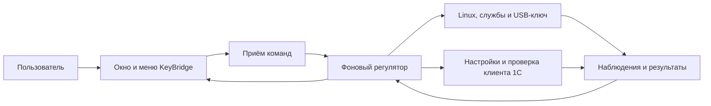

# Как модель реализована в приложении

[Модель управления](control-model.md) задаёт правила, а [пользовательские сценарии](README.md) описывают наблюдаемое поведение. Здесь показано, какие части программы выполняют эти правила и где реализация ещё не обеспечивает целевой результат.

## Из чего состоит KeyBridge

| Часть | Ответственность | Где находится |
| --- | --- | --- |
| Окно и меню | Показывают состояние, принимают выбор пользователя, открывают системный выбор файла; закрытие окна оставляет фоновую работу | [KeyBridgeApp.swift](../Sources/KeyBridgeApp/KeyBridgeApp.swift), [KeyBridgeWindow.swift](../Sources/KeyBridgeApp/KeyBridgeWindow.swift), [Resources/interface](../Resources/interface) |
| Связь окна с программой | Проверяет выбранные файлы, отправляет команды и ждёт результат конкретного запроса; устаревший ответ не меняет новый экран | [AppModel.swift](../Sources/KeyBridgeApp/AppModel.swift), [ApplicationCommandFlow.swift](../Sources/KeyBridgeCore/ApplicationCommandFlow.swift), [ApplicationSubmissionQueue.swift](../Sources/KeyBridgeCore/ApplicationSubmissionQueue.swift) |
| Представление состояния | Превращает наблюдения в понятные состояния, сообщения и сведения о ресурсах; не подменяет неизвестность успехом | [AppPresentation.swift](../Sources/KeyBridgeCore/AppPresentation.swift) |
| Приём команд | Передаёт запрос единственному агенту, отдельно возвращает принятие и результат; поддерживает связь без обязательной записи ответа на диск | [KeyBridgeControl](../Sources/KeyBridgeControl/main.swift), [AgentIPC.swift](../Sources/KeyBridgeCore/AgentIPC.swift), [ControlSupport.swift](../Sources/KeyBridgeCore/ControlSupport.swift) |
| Регулятор | Хранит намерение, выбирает допустимое действие, ограничивает восстановление, обрабатывает сон и вход, согласует состояние после перезапуска | [KeyBridgeAgent](../Sources/KeyBridgeAgent/main.swift), [OperationJournal.swift](../Sources/KeyBridgeCore/OperationJournal.swift), [RuntimeAuthorization.swift](../Sources/KeyBridgeCore/RuntimeAuthorization.swift) |
| Управление Linux | Готовит установку, запускает и останавливает виртуальную машину, проверяет связь, службы и ключ | [VMEngine.swift](../Sources/KeyBridgeCore/VMEngine.swift), [гостевые команды](../Resources/guest) |
| Владение процессом и ключом | Различает свой процесс, отсутствие и неизвестность; связывает подключение ключа с наблюдаемым событием | [ProcessOwnership.swift](../Sources/KeyBridgeCore/ProcessOwnership.swift), [USBMonitor.swift](../Sources/KeyBridgeCore/USBMonitor.swift) |
| Сохранённые установки | Проверяет пригодность файлов, публикует новую текущую установку и выбирает сохранённую для возврата | [GenerationStore.swift](../Sources/KeyBridgeCore/GenerationStore.swift), [PreparationSession.swift](../Sources/KeyBridgeCore/PreparationSession.swift) |
| Настройки клиента 1С | Находит установленный клиент, изменяет только предусмотренные настройки с правами macOS, сохраняет копию и проверяет возможность возврата | [ClientInstallation.swift](../Sources/KeyBridgeCore/ClientInstallation.swift), [KeyBridgeConfigure](../Sources/KeyBridgeConfigure/main.swift), [ConfigurationBackupMetadata.swift](../Sources/KeyBridgeCore/ConfigurationBackupMetadata.swift) |

Регулятор работает в агенте, поэтому закрытие окна не прекращает раздачу. Окно читает наблюдения; открытие окна само по себе не является командой включения. При холодном запуске отсутствие файлов состояния не считается доказательством отсутствия работающей виртуальной машины.

## Подготовка и замена программ

Соответствует [сценариям подготовки](scenarios/preparation.md).

Приложение поставляется с готовой основой Alpine и glibc. Основа собирается [при сборке приложения](../scripts/build-alpine-base.py), а пользовательская подготовка выполняется в её независимой копии. В поставке нет пользовательских установщиков и установленных закрытых компонентов.

Сразу после выбора [разбор архивов](../Sources/KeyBridgeCore/ImportArchive.swift) читает ZIP и tar, включая вложенные архивы, и сохраняет компоненты в закрытом временном каталоге. Готовые `.run` и `.deb` также копируются туда. Архивные пути не используются как пути записи; объём и глубина распаковки ограничены. Если найдено несколько подходящих компонентов, выбор делает пользователь. Исходный архив не изменяется.

[ImportValidation](../Sources/KeyBridgeCore/ImportValidation.swift) проверяет формат и архитектуру установщика, а для HASP — метаданные пакета `aksusbd` для `amd64`, архив данных и нужные исполняемые программы x86-64. [Проверка установщика](../Sources/KeyBridgeCore/InstallerPreflight.swift) запускает `--version` и `--help` в отдельной Alpine без USB и установки компонентов. Узнаваемый ответ 1С и наличие `lic_manager` в объявленном составе обязательны до разрешения продолжить. Результат относится к конкретной сохранённой копии; устаревшая проверка не заменяет новый выбор. На установку передаются проверенные копии, а не заново прочитанные исходные архивы.

Номер выпуска и заранее известная контрольная сумма не служат списком разрешённых поставок. Контроль целостности переноса файлов — отдельная проверка. Объявленный состав не гарантирует успешной установки: гостевые проверки состава, наличия единственного исполняемого менеджера и готовности служб сохраняются.

[VMEngine](../Sources/KeyBridgeCore/VMEngine.swift) оценивает свободное место на Mac, создаёт копию основы и передаёт установщики. [Гостевая подготовка](../Resources/guest/alpine_provision.sh) проверяет состав, устанавливает драйвер и менеджер лицензий без загрузки пакетов из сети, настраивает защиту и проверяет готовность служб. Рабочий профиль — 128 МиБ памяти и один виртуальный процессор. Временный файл подкачки используется при установке и удаляется до готовности.

Текущая установка меняется после успешной подготовки. Предыдущая остаётся доступной для явного возврата. Публикация и принятие остановки согласованы через журнал операций: отменённая подготовка не получает права позже заменить текущую установку. После прерывания программа выясняет, была ли новая установка опубликована.

Возврат разрешён при подтверждённой остановке. Проверяются сохранённые сведения, обычные файлы и целостность диска; затем меняется выбор текущей установки. Неподтверждённая лицензия после обновления сама по себе не вызывает автоматический возврат. Подготовка и возврат сохраняют запрет возобновления после явного выключения.

## Включение, работа и выключение

Соответствует [сценариям работы](scenarios/operation.md).

Перед запуском регулятор проверяет разрешение на работу, активность сеанса, настройки клиента, пригодность установки и владение процессом. Запуск следует порядку: виртуальная машина, связь с ней, службы, защита ключа, передача единственного допустимого ключа и подтверждение подключения.

Ошибка одного канала связи не означает, что виртуальная машина отсутствует. Неизвестное владение запрещает второй запуск и действия над неподтверждённым процессом. Занятый чужой порт не освобождается принудительно. Наблюдение USB учитывает изменение подключения; старая запись о ключе не подтверждает новое подключение.

Когда работа разрешена, отказ виртуальной машины или служб запускает ограниченное восстановление. Попытка расходуется до нового запуска. Отсутствие ключа оставляет ожидание подключения; неоднозначность ключей и неизвестная защита вызывают защитную остановку и запрещают автоматическое возобновление.

Остановка доступна при выполнении другой операции. Обычная новая команда в это время отклоняется, повтор остановки присоединяется к уже выполняемой. Порядок отправки запросов не позволяет ранее запущенной отправке команды включения обогнать последующее выключение.

У остановки два независимых результата: прекращена ли работа и сохранён ли запрет возобновления. Ошибка записи не отменяет физическую попытку остановить подтверждённо свой процесс. Выход из приложения завершается только после подтверждённой остановки и сохранения запрета; при отказе сохранения запрос выхода остаётся ожидающим повторного действия.

После падения агента незавершённая команда не повторяется вслепую. Агент заново проверяет фактическое состояние. Если непрерывность прежнего подключения USB установить нельзя, свой старый запуск останавливается перед новым подключением. Сохранённое выключение имеет приоритет перед восстановлением и новым входом.

## Диагностика и занятые лицензии

Соответствует [сценариям диагностики](scenarios/diagnostics.md).

Монитор лицензий открывается установленным клиентом 1С. Если открытие не подтверждено, интерфейс предлагает повтор и инструкцию просмотра в своей базе. KeyBridge не выводит собственное число свободных лицензий из факта доступности ключа или порта.

Проверка в 1С запускается по запросу из диагностики. [Агент](../Sources/KeyBridgeAgent/main.swift) создаёт отдельную пустую базу, выполняет операцию клиентом и сопоставляет её результат с наблюдениями менеджера лицензий. [Сборщик](../Resources/guest/license_evidence.py) и [проверка непрерывности журнала](../Sources/KeyBridgeCore/LicenseEvidence.swift) учитывают доступность журнала, изменение его основы и контекст запуска.

Смена установки, запуска, служб или подключения ключа отзывает актуальность прежнего результата. Операция может опубликовать результат только пока её разрешение остаётся действующим. Готовая служба и успешная операция клиента не объявляются доказательством аппаратного источника лицензии.

**Положительный исход проверки пока не реализован.** Сборщик наблюдает общие события выдачи, но не связывает их с конкретным запущенным процессом 1С. Поэтому аппаратный источник лицензии остаётся неподтверждённым, даже если клиент отработал и события выдачи появились.

Есть и отдельное расхождение с целевой моделью: код требует прироста общих счётчиков и при его отсутствии помечает пробу неудачной. Это не доказывает отказ лицензии: использование уже выданной компьютеру лицензии может не дать новой выдачи. Реализация должна различать ошибку операции 1С и успешную операцию с неподтверждённым источником. Одного ослабления проверки счётчиков недостаточно — всё равно нужна причинная связь с аппаратным ключом.

## Настройки и ресурсы

Соответствует [сценариям настроек](scenarios/settings.md).

Настройка клиента, явное исправление внешних изменений и возврат выполняются отдельным помощником с правами macOS. Помощник принимает ограниченные операции и сам находит допустимую цель. Разрешение привязано к действующей операции агента; запоздавшее подтверждение прав не разрешает отменённое изменение.

Обычная настройка не перезаписывает внешние изменения. Явное исправление сохраняет копию перед заменой. Возврат проверяет метаданные копии и текущее содержимое; отсутствующая или повреждённая копия не становится основанием удалить настройки.

Выбор автозапуска хранится отдельно от разрешения macOS. Отказ записи предпочтения оставляет несохранённый выбор в интерфейсе до повтора или отмены. Отказ регистрации не изображается включённым автозапуском. Выключение автозапуска не останавливает уже работающий KeyBridge; включение может разрешить следующий вход после явного выбора пользователя.

Возможность автозапуска определяется отдельно по `KeyBridgeLoginLaunchSupported` в `Info.plist` приложения. В предварительной сборке с подписью ad-hoc она выключена: интерфейс объясняет ограничение, а регулятор не сохраняет разрешение на недоступное действие. Неизвестная возможность также не считается разрешённой.

[RuntimeResources](../Sources/KeyBridgeCore/RuntimeResources.swift) и [VMEngine](../Sources/KeyBridgeCore/VMEngine.swift) измеряют память Linux, подкачку и события нехватки памяти отдельно от памяти процесса на Mac. Для диска различаются занятые блоки, логический размер файлов и виртуальная ёмкость. Учитываются основа, текущая, предыдущая, другие сохранённые и незавершённые установки.

У измерения есть время и контекст. После изменения работы прежние значения показываются как исторические. Недоступное измерение не заменяется нулём; подтверждённое отсутствие объекта может иметь нулевой размер. У опубликованных установок нет автоматического удаления или общего лимита хранения.

## Представление согласованных сценариев

Рабочий интерфейс находится в [HTML](../Resources/interface/keybridge.html) и [JavaScript](../Resources/interface/keybridge.js), загруженных в локальный WKWebView. Демонстрационные состояния находятся в [тестовых данных](../Tests/Interface) и не входят в рабочий экран.

Окно имеет разделы «Ключ» и «Настройки», минимальный размер 760 × 560 вместе с системным заголовком macOS. Стандартные кнопки в левом верхнем углу закрывают, сворачивают и увеличивают окно. Закрытие окна сохраняет работу KeyBridge; повторное открытие через Dock или меню возвращает то же окно, в том числе из свёрнутого состояния. Прокручивается центральная область; вкладки и общая нижняя панель действий сохраняют место. Кнопки стоят в один ряд, а подписи в панели и пары «параметр — значение» не переносятся на две строки. Название, размер и положение «Проверить в 1С» постоянны в сценарии диагностики.

Главный экран посвящён работе ключа и занятым лицензиям. Проверка лицензии и её результат находятся в диагностике. Возврат предыдущей установки доступен в контексте проблемы обновления; отдельного каталога установок нет.

В основном разделе настроек находится блок Ingvar Consulting по образцу efd_unpacker. Логотип включён в локальные ресурсы приложения; единственная ссылка открывает сайт во внешнем браузере. Адрес разрешён нативным обработчиком ссылок. Блок прокручивается вместе с содержимым и не меняет нижнюю панель действий.

Ошибка появляется рядом с действием или объектом, объясняет случившееся, известную причину и следующий шаг. Если причина неизвестна, сообщение говорит об этом прямо. Сообщения не вставляются над заголовком и не сдвигают остальные элементы. После изменения существенного состояния старое сообщение удаляется. Навигация и выбранные файлы сохраняются при обычном обновлении наблюдений.

## Что подтверждают проверки

| Проверки | Область вывода |
| --- | --- |
| [Тесты ядра](../Tests/KeyBridgeCoreTests) | Владение, порядок команд, отмена и публикация, сохранённое намерение, пригодность установок, проверки файлов и копий настроек, USB, ресурсы и представление состояния |
| [Тесты гостевых команд](../Tests/Guest) | Распознавание установщиков, ответы защиты, готовность менеджера и чтение лицензионных событий на заданных данных |
| [Тесты интерфейса](../Tests/Interface/state.test.cjs) и [браузерные состояния](../Tests/Interface/fixture.html) | Навигация, старые ответы, локальные ошибки, повтор и отмена, компоновка согласованных состояний |
| Нативная проверка отдельной сборки | Реальный системный выбор файла, отклонение неподходящего установщика, блокировка продолжения и выход через остановку в пустом отдельном хранилище |
| [Проверка поставки](../scripts/source-archive.py) | Допустимый состав приложения, подпись и отсутствие включённых пользовательских установщиков, закрытых компонентов и рабочих дисков |

Эти проверки не доказывают соответствие всей программы модели. Нативный проход в пустом хранилище не подтверждает физическое освобождение подключённого ключа. Проверка состояния на тестовых данных не подтверждает реальный вход в macOS, сон или выдачу лицензии.

## Что ещё не обеспечено или не подтверждено

| Область | Текущая граница |
| --- | --- |
| Аппаратный источник лицензии | Нет причинной связи между событием выдачи и нашей пробой; успешное подтверждение недостижимо. Отсутствие прироста счётчика требует отдельного исхода, отличного от ошибки клиента |
| Место на диске | Есть предварительная оценка места на Mac; предварительного расчёта достаточности места внутри Linux нет |
| Повреждение данных | Проверяются сведения об установке и формат диска; целостность диска проверяется при подготовке и возврате. Полное обнаружение повреждения основы и восстановление после грязного завершения не обеспечены; запись признака такого завершения сама по себе не восстанавливает диск |
| Нехватка памяти | Доступны измерения и ограниченное восстановление. Автоматическая классификация отказа именно как нехватки памяти и натурная проверка этого поведения не завершены |
| Хранение | Сохранённые установки учитываются и не удаляются автоматически. Общий предел занимаемого места и политика очистки не определены |
| Физическая приёмка | Требуются сквозные проверки выдачи лицензии, возврата между установками, падения агента и служб, потери каналов связи, замены ключа, отказов записи и ресурсов, прав macOS, нового входа и сна |
| Доказательство соответствия | Нет доказательства, что переходы Swift и гостевых команд уточняют модель при всех допустимых последовательностях событий; локальные тесты этого не заменяют |

Несохранённое выключение после потери всей оперативной памяти невозможно отличить от отсутствия команды выключения. Это предел доступной информации, а не исправимый одной новой проверкой дефект. До падения программа всё равно обязана попытаться остановить свою работу и показать отказ сохранения.
